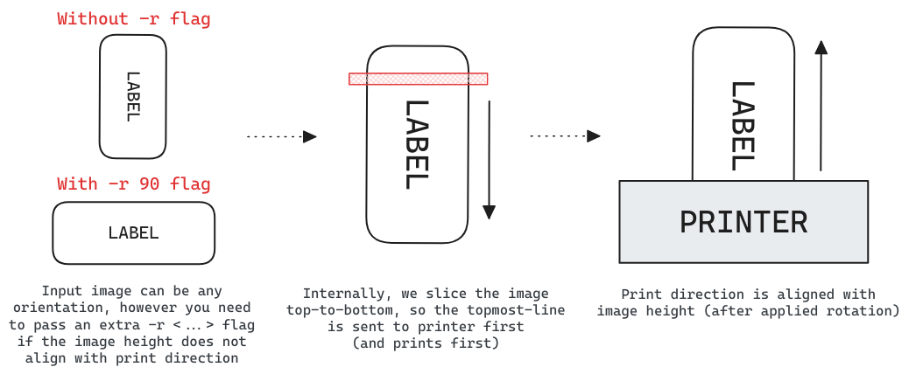
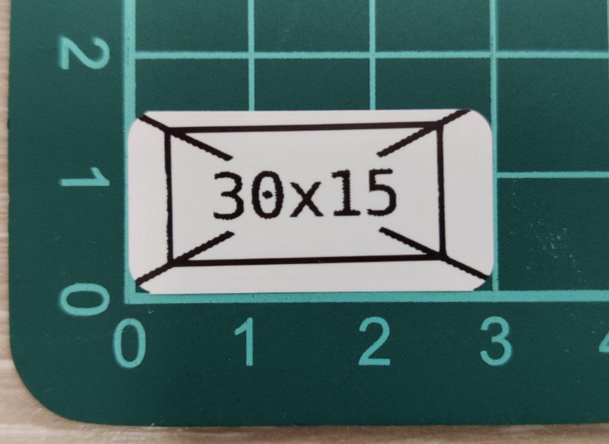
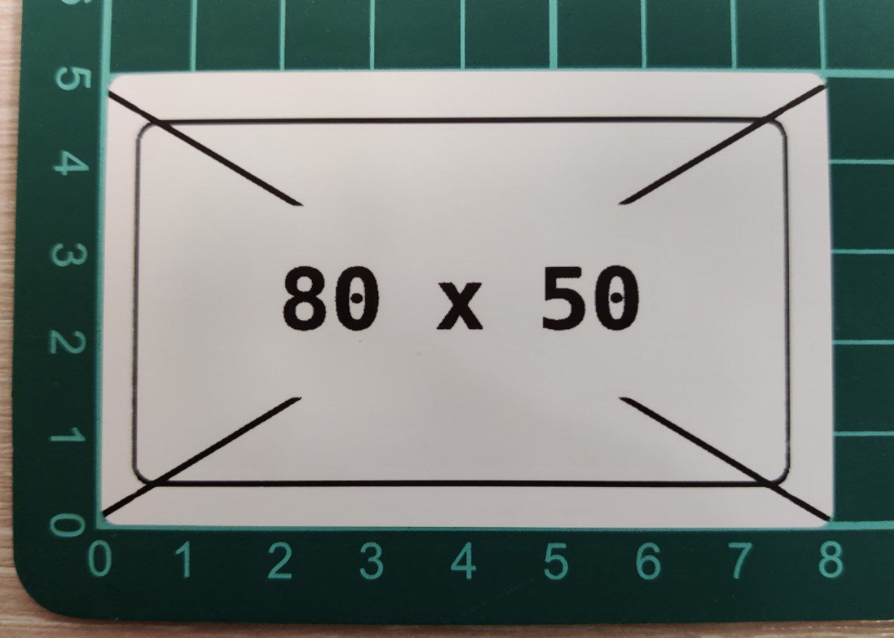

# `niimprint` &mdash; Niimbot Printer Client

**Fork changelog & differences from original version:**

- Tested on Niimbot B1, B18, B21, D11, D110, M2 and Python 3.11
- Added transport abstraction: switch between bluetooth and USB (serial)
- Disabled checksum calculation for image encoding (works fine without it so far)
- Switched to [click](https://click.palletsprojects.com/) CLI library instead of argparse
- Integrated [pyproject.toml](https://pip.pypa.io/en/stable/reference/build-system/pyproject-toml/) and [poetry](https://python-poetry.org)
- Integrated [pre-commit](https://pre-commit.com/) and [ruff](https://docs.astral.sh/ruff/), re-formatted all files
- Miscellaneous refactoring / file renaming / etc.

## Installation

Recommended method is to use [poetry](https://python-poetry.org) and install with `poetry install`. However `requirements.txt` is also provided for convenience. Project is tested on Python 3.11, but should work on other versions.

## Usage

```
$ python niimprint --help

Usage: niimprint [OPTIONS]

Options:
  -m, --model [b1|b18|b21|d11|d110|m2]     Niimbot printer model  [default: b21]
  -c, --conn [usb|bluetooth]   Connection type  [default: usb]
  -a, --addr TEXT              Bluetooth MAC address OR serial device path
  -d, --density INTEGER RANGE  Print density  [default: 5; 1<=x<=5]
  -r, --rotate [0|90|180|270]  Image rotation (clockwise)  [default: 0]
  -i, --image PATH             Image path  [required]
  -v, --verbose                Enable verbose logging
  --help                       Show this message and exit.
```

### Image orientation:

Generally, the image comes out of the printer with the same orientation you see it on your screen. You can have your input image rotated as you like, but adjust its orientation by passing `-r <...>` flag. See the image below for clarification.

[]()

<!-- Excalidraw link: https://excalidraw.com/#json=vYHMBohMn5GeB-5M6SNch,TsxRmh_WKUfzYjL183FGfg -->

### Image resolution:

As far as we've tested, most Niimbot printers have **8 pixels per mm** (~203 dpi) resolution — **the M2 we tested is 300 dpi** (~11.8 px/mm); resolution may also vary by hardware revision on other models (see #44 re: D11). The CLI prints the image you provided as-is, without any checks of the actual label size, so be careful. However the script will check if the image width is too big for selected printer. The maximum width in pixels is usually slightly less than specified maximum width in mm:

- **B21, B1, B18**: max 384 pixels (almost equal to 50 mm * 8 px/mm = 400)
- **D11**: max 96 pixels (almost equal to 15 mm * 8 px/mm = 120)
- **M2**: max 567 pixels (48 mm max print width * 300 dpi / 25.4)

### M2 notes

The M2 differs from the other supported models in a couple of ways:

- It's a thermal *transfer* printer (needs a ribbon), not direct thermal — a missing/
  exhausted/misaligned ribbon prints a blank label with no error.
- Its print head needs real time to actually fire after the image data is sent. Ending
  the job on the same fixed ~0.3s timing used for the other models here causes it to
  silently discard the buffered image (also a blank label, no error) — this is the
  same root cause as #21/#3 reported on B1/B21. Rather than guess a fixed delay, the
  `m2` CLI model polls `get_print_status()` and waits for it to report the page
  complete (`print_image(..., wait_for_status=True)`); other models keep the existing
  fixed-delay behavior unchanged. This also fixes `get_print_status()` itself, which
  previously raised on the M2 — its status packet has 6 extra trailing bytes past the
  `{page, progress1, progress2}` fields the other models return.
- On at least one USB-connected unit, it enumerated as **two** separate serial ports;
  only one was the actual data channel; the other never responded. If USB printing
  seems to hang or do nothing, try the other port.
- Leave a margin of at least ~2mm on all four edges of your label design, and keep the
  leading edge of your design (`y=0`) essentially edge-to-edge — this unit printed
  right up to the true top edge with no gap, but needed a couple mm of clearance on
  the other three sides. Content also came out shifted ~1-1.5mm towards one side of
  the label rather than perfectly centered; this may be specific to this unit/roll
  rather than universal.

### USB connection:

For USB connection, you can omit the `--addr` argument and let the script auto-detect the serial port. However, it will fail if there're multiple available ports. On linux, serial ports can be found at `/dev/ttyUSB*`, `/dev/ttyACM*` or `/dev/serial/*`. On windows, they will be named like `COM1`, `COM2` etc. Check the device manager to choose the correct one.

### Bluetooth connection:

It seems like B21 and B1 (and maybe other models?) have two bluetooth adresses. They have the same last 3 bytes, but the first 3 are rotated (for example `AA:BB:CC:DD:EE:FF` and `CC:AA:BB:DD:EE:FF`). Connection works only if you disconnect from one and connect to the other. After connecting via bluetoothctl you may get `org.bluez.Error.NotAvailable br-connection-profile-unavailable` error, but printing works fine regardless.

To identify which address is the correct one, run `bluetoothctl info` on the address you want to check. The incorrect one might list `UUID: Generic Access Profile` and `UUID: Generic Attribute Profile`, while the correct one will list `UUID: Serial Port`.

## Examples

**B21, USB connection, 30x15 mm (240x120 px) label**

```
python niimprint -c usb -a /dev/ttyACM0 -r 90 -i examples/B21_30x15mm_240x120px.png
```

[]()

**B21, Bluetooth connection, 80x50 mm (640x384 px) label**

```
python niimprint -c bluetooth -a "E2:E1:08:03:09:87" -r 90 -i examples/B21_80x50mm_640x384px.png
```

[]()

## Licence

[MIT](https://choosealicense.com/licenses/mit/). Originally developed by [kjy00302](https://github.com/kjy00302), forked & enhanced by [AndBondStyle](https://github.com/AndBondStyle)
